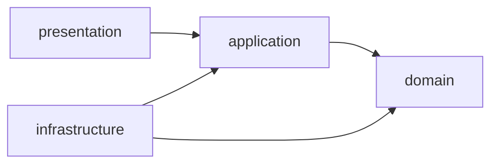

# educfin-ai

Boilerplate de **autenticação** com **Java 25 + Spring Boot 4.1**, organizado em **Clean Architecture** e seguindo os princípios **SOLID**.

Funcionalidades:

- Cadastro de usuário (nome, e-mail, senha)
- Login com e-mail/senha → **access token** + **refresh token** (JWT HS256, stateless)
- Renovação de tokens via refresh token
- Endpoint protegido `GET /api/v1/users/me`
- PostgreSQL + Flyway, erros padronizados (RFC 9457 – Problem Details), Swagger/OpenAPI

---

## Como rodar

Pré-requisitos: **Java 25** e **Docker**.

```bash
cp .env.example .env            # opcional: ajuste as variáveis
docker compose up -d            # sobe o PostgreSQL
./mvnw spring-boot:run          # sobe a API em http://localhost:8080
./mvnw test                     # roda os testes (usa Docker para o Testcontainers)
```

- Swagger UI: http://localhost:8080/swagger-ui.html
- Health: http://localhost:8080/actuator/health

> Sem Java instalado? Dá para compilar via Docker:
> `docker run --rm -v "$PWD":/app -w /app maven:3.9-eclipse-temurin-25 mvn package`

### Variáveis de ambiente

| Variável                | Padrão                                    | Descrição                          |
|-------------------------|-------------------------------------------|------------------------------------|
| `DB_URL`                | `jdbc:postgresql://localhost:5432/educfin`| URL JDBC                           |
| `DB_USERNAME`           | `educfin`                                 | Usuário do banco                   |
| `DB_PASSWORD`           | `educfin`                                 | Senha do banco                     |
| `JWT_SECRET`            | *(valor só para dev)*                     | Chave HMAC, **mínimo 32 caracteres** |
| `JWT_ISSUER`            | `educfin-ai`                              | Claim `iss`                        |
| `JWT_ACCESS_TOKEN_TTL`  | `15m`                                     | Validade do access token           |
| `JWT_REFRESH_TOKEN_TTL` | `7d`                                      | Validade do refresh token          |

> [!WARNING]
> Defina sempre `JWT_SECRET` fora do ambiente local (ex.: `openssl rand -base64 48`).

---

## Endpoints

| Método | Rota                     | Auth   | Descrição                          |
|--------|--------------------------|--------|------------------------------------|
| POST   | `/api/v1/auth/register`  | —      | Cadastra usuário (201)             |
| POST   | `/api/v1/auth/login`     | —      | Retorna access + refresh token     |
| POST   | `/api/v1/auth/refresh`   | —      | Gera novo par de tokens            |
| GET    | `/api/v1/users/me`       | Bearer | Dados do usuário autenticado       |

```bash
curl -X POST localhost:8080/api/v1/auth/register -H 'Content-Type: application/json' \
  -d '{"name":"Maria","email":"maria@example.com","password":"Senha123"}'

curl -X POST localhost:8080/api/v1/auth/login -H 'Content-Type: application/json' \
  -d '{"email":"maria@example.com","password":"Senha123"}'

curl localhost:8080/api/v1/users/me -H "Authorization: Bearer <accessToken>"
```

---

## Arquitetura

```
src/main/java/com/educfin
├── domain/                      # Regras de negócio puras (zero dependência de framework)
│   ├── exception/DomainException
│   └── user/                    # User (entidade), Email, UserId (value objects), PasswordPolicy
│
├── application/                 # Casos de uso (zero dependência de Spring)
│   ├── port/in/                 # Interfaces dos casos de uso (RegisterUserUseCase, ...)
│   ├── port/out/                # Interfaces de saída (UserRepository, PasswordHasher, TokenProvider)
│   ├── usecase/                 # Implementações dos casos de uso
│   ├── dto/                     # AuthTokens, UserOutput
│   └── exception/               # Erros de aplicação
│
├── infrastructure/              # Detalhes técnicos (implementam as portas de saída)
│   ├── persistence/             # JPA entity, Spring Data repo, mapper, UserRepositoryAdapter
│   ├── security/                # SecurityConfig, BCryptPasswordHasher, jwt/ (JwtTokenProvider, ...)
│   └── config/UseCaseConfig     # Composition root: instancia os casos de uso como beans
│
└── presentation/                # Entrada HTTP
    ├── controller/              # AuthController, UserController
    ├── dto/request|response/    # Contratos HTTP
    ├── handler/                 # GlobalExceptionHandler (Problem Details)
    └── config/OpenApiConfig
```



**Regra de dependência:** as setas apontam sempre para dentro. `domain` não conhece ninguém; `application` conhece apenas `domain`; `infrastructure` e `presentation` dependem das abstrações de `application`.

### SOLID aplicado

- **S — Single Responsibility:** cada caso de uso é uma classe com um único método `execute`; controllers apenas traduzem HTTP ↔ caso de uso; mapeamentos ficam em mappers dedicados; a entidade JPA é separada da entidade de domínio.
- **O — Open/Closed:** trocar BCrypt por Argon2, JWT por tokens opacos ou PostgreSQL por outro banco exige apenas **um novo adapter** que implemente a porta — nenhum caso de uso muda.
- **L — Liskov Substitution:** qualquer implementação de `UserRepository`, `PasswordHasher` ou `TokenProvider` (ex.: fakes em memória para testes) é substituível sem alterar o comportamento esperado pelos casos de uso.
- **I — Interface Segregation:** portas pequenas e focadas (`PasswordHasher` não sabe de tokens; `TokenProvider` não sabe de persistência) e uma interface por caso de uso, de modo que cada controller depende só do que usa.
- **D — Dependency Inversion:** os casos de uso dependem de interfaces (`port/out`), e a infraestrutura as implementa. A ligação é feita em `UseCaseConfig`, mantendo a camada de aplicação livre de anotações do Spring.

### Como adicionar uma nova funcionalidade

1. Regras/invariantes novas → `domain`.
2. Crie a interface do caso de uso em `application/port/in` e a implementação em `application/usecase`.
3. Se precisar de algo externo, declare uma porta em `application/port/out` e implemente o adapter em `infrastructure`.
4. Registre o bean em `UseCaseConfig`.
5. Exponha via controller em `presentation`.
